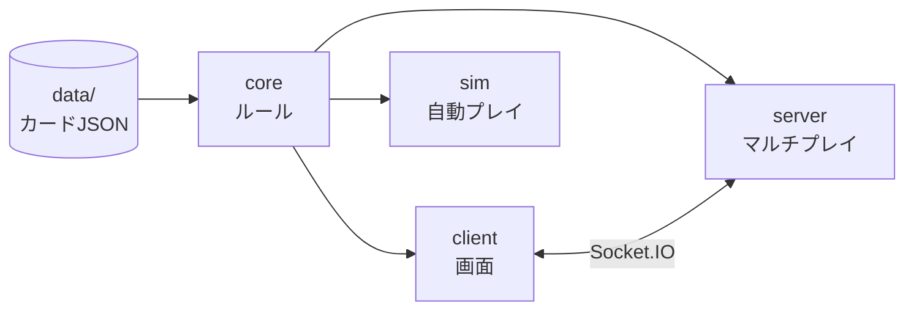
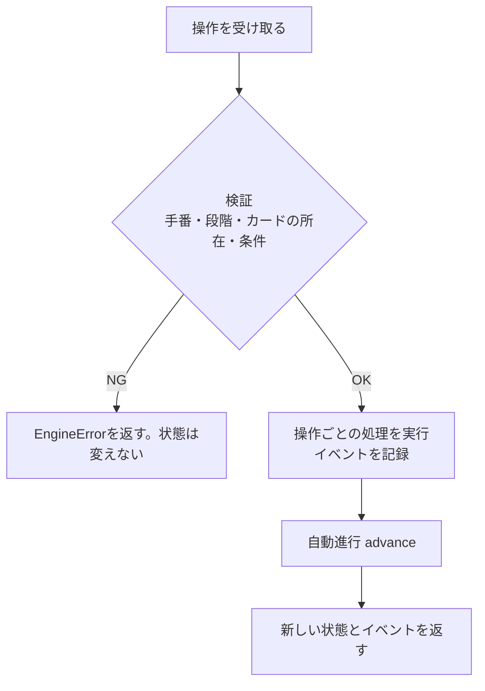
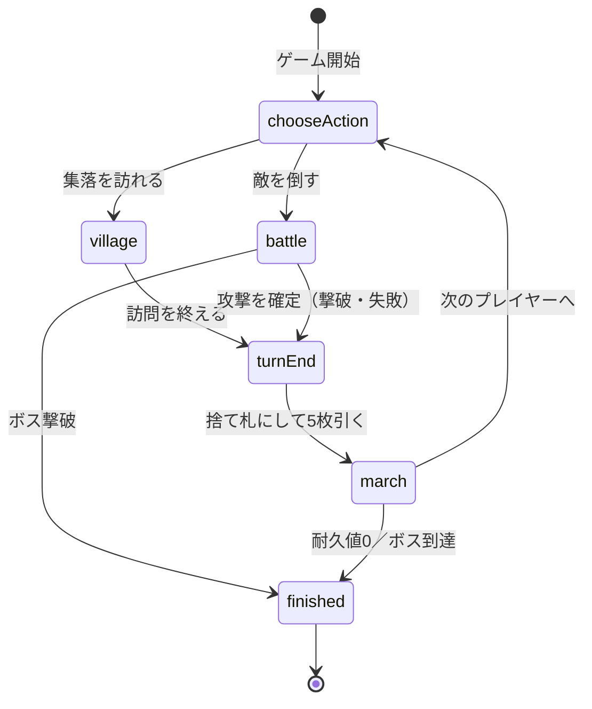
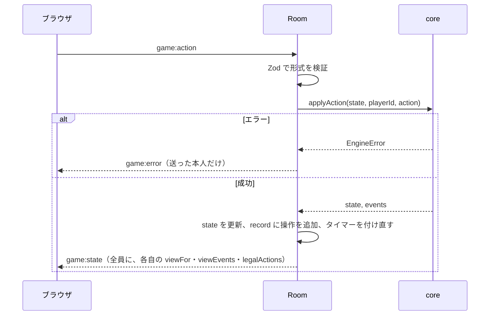

# デッキビルドRPG 設計書

> 本書は「仕様書.md」の内容を、どのようなプログラムの作りで実現するかを定めたものです。
> ゲームのルールそのものは仕様書に書き、本書には書きません（ルールは「仕様書 5.2」のように参照します）。
> 仕様書の「8. プログラムの構成」の型は概要です。細かい型は本書を正とします。

| 版 | 日付 | 内容 |
|---|---|---|
| 0.1 | 2026-11-08 | 初版 |
| 0.2 | 2026-11-08 | 行動の選び直し（cancelAction）、撃破時に進軍しない（turnEnd.skipMarch） |

---

## 1. 全体の構成

### 1.1 方針

1. **ルールは `core` に集める**。`core` は画面・通信・時刻に依存しない、純粋なTypeScriptのコードにする。
2. **状態の変化は「状態 ＋ 操作 → 新しい状態」の関数だけで起こす**。同じ状態と同じ操作からは必ず同じ結果になる。
3. **ソロもマルチも同じ `core` を使う**。ソロはブラウザの中で、マルチはサーバーで `core` を動かす。
4. **カードの性能はJSONデータで持つ**。プログラムにはカード固有の数値を書かない。

### 1.2 パッケージ



| パッケージ | 役割 | 依存してよいもの |
|---|---|---|
| `core` | ゲームのルール、状態、操作の検証、見える情報の切り出し | `data`、Immer、Zod |
| `client` | ブラウザの画面。ソロのときは `core` を直接動かす | `core`、React、Zustand、Socket.IO client |
| `server` | ルーム管理、`core` の実行、状態の配信 | `core`、Socket.IO |
| `sim` | 自動プレイでの大量試行（バランス調整用、計画書フェーズ3） | `core` |

- `core` が `client` や `server` に依存することはない（逆向きの依存は禁止）。

### 1.3 フォルダ構成

```
DeckBuildRPG/
├─ package.json            … npm workspaces の設定
├─ tsconfig.base.json
├─ data/
│  ├─ heroes.json
│  ├─ items.json           … 食料・武器・呪い
│  ├─ enemies.json
│  ├─ setup.json           … ルールの設定、初期デッキ、在庫の枚数
│  └─ stages.json          … ステージ（登場するカード、ボス、人数ごとの設定）
└─ packages/
   ├─ core/
   │  └─ src/
   │     ├─ index.ts       … 外に公開するもの
   │     ├─ types/         … 状態・操作・イベントの型
   │     ├─ data/          … JSONの読み込みと検証
   │     ├─ setup.ts       … ゲームの準備
   │     ├─ engine.ts      … 操作の受け付けと自動進行
   │     ├─ actions/       … 操作ごとの処理（village.ts, battle.ts, …）
   │     ├─ effects/       … 村効果・敵の能力の処理
   │     ├─ march.ts       … 敵の進軍
   │     ├─ rules/         … 計算（所持金、ダメージ、できる操作の一覧）
   │     ├─ view.ts        … プレイヤーごとに見える情報の切り出し
   │     ├─ rng.ts         … 乱数
   │     └─ replay.ts      … 記録からの再現
   ├─ client/
   ├─ server/
   └─ sim/
```

### 1.4 使う技術

| 用途 | ライブラリ | 理由 |
|---|---|---|
| 言語 | TypeScript（strict） | 全パッケージで型を共有する |
| 状態の更新 | Immer | 書きやすさを保ったまま、元の状態を壊さずに新しい状態を作れる |
| データ・通信の検証 | Zod | JSONとブラウザから届く操作を、実行時に型チェックする |
| 画面 | React + Vite | |
| 画面の状態管理 | Zustand | 小さく、React外（通信処理）からも更新しやすい |
| 通信 | Socket.IO | 再接続とルーム機能がある |
| テスト | Vitest | |

---

## 2. core の設計

### 2.1 カード定義とカードの個体

カードは「定義」と「個体」に分ける。

```ts
// 定義：JSONから読み込む。ゲーム中は変わらない
type CardDef = HeroDef | WeaponDef | FoodDef | EnemyDef | CurseDef;   // 項目は仕様書 2章
type CardId = string;            // 例 "hero_knight_2"

// 個体：ゲーム中の1枚1枚。状態にはこれだけを入れる
type CardInstance = { uid: string; defId: CardId };
```

- 状態にはカードの性能を入れず、`defId` から `CardRegistry`（定義の一覧）を引いて性能を得る。
- `uid` は `"c" + 連番`。連番は状態の `nextUid` で管理し、乱数を使わない。

```ts
type CardRegistry = {
  get(id: CardId): CardDef;
  heroLevels(heroId: HeroId): HeroDef[];   // Lv順
};
```

### 2.2 ゲーム状態

```ts
type GameState = {
  version: 1;                       // 状態の形式の版（保存データの互換性のため）
  seed: number;
  rng: number;                      // 乱数の現在の状態
  nextUid: number;
  config: GameConfig;               // 人数ごとの設定（仕様書 6.2）
  players: PlayerState[];           // 手番順
  currentPlayer: number;            // players の添字
  turnCount: number;
  step: Step;                       // 今どの段階か（2.4）
  turn: TurnState | null;           // 手番中の一時的な状態
  pending: Pending | null;          // 入力待ち（2.5）
  effectQueue: QueuedEffect[];      // これから処理する効果（2.6）
  village: VillageState;
  enemyDeck: CardInstance[];        // 先頭が一番上
  route: CardInstance[][];          // route[0] が1マス目
  villageHp: number;
  trash: CardInstance[];            // 廃棄されたカード
  result: GameResult | null;
};

type VillageState = {
  stacks: Record<StackId, CardInstance[]>;   // 英雄6・食料4・武器6。先頭が一番上
  curses: CardInstance[];
};
```

- ログは状態に含めず、操作のたびに返す **イベント**（2.7）として外に出す。状態を小さく保ち、通信量を減らすため。

### 2.3 エンジンの入口

`core` が外に公開する主な関数。

```ts
// ゲームを作る
function createGame(params: { seed: number; players: { id: string; name: string }[] },
                    registry: CardRegistry): EngineResult;

// 操作を1つ実行し、自動で進められるところまで進める
function applyAction(state: GameState, playerId: string, action: Action,
                     registry: CardRegistry): EngineResult | EngineError;

type EngineResult = { state: GameState; events: GameEvent[] };
type EngineError  = { error: ErrorCode; message: string };

// 今そのプレイヤーができる操作の一覧（画面のボタンの有効・無効に使う）
function legalActions(state: GameState, playerId: string, registry: CardRegistry): LegalActions;

// そのプレイヤーに見せてよい情報だけにした状態（仕様書 6.3）
function viewFor(state: GameState, playerId: string): PlayerView;

// 入力待ちが時間切れになったときに使う操作
function timeoutAction(state: GameState, playerId: string): Action | null;
```

`applyAction` の中の流れ：



- 検証に失敗した場合は、状態を一切変えずにエラーを返す。
- 処理はImmerの `produce` の中で行い、元の `state` は変更しない。

### 2.4 段階（Step）と自動進行

ゲームは次の段階を順に進む。



```ts
type Step =
  | { kind: "chooseAction" }
  | { kind: "village" }
  | { kind: "battle" }
  | { kind: "turnEnd"; skipMarch: boolean }                // 撃破した手番は march を飛ばして nextTurn へ
  | { kind: "march"; phase: "move" | "onMarch" | "reveal" }   // move で集落への到達まで処理する
  | { kind: "nextTurn" }                                     // 公開時の能力を処理し終えてから次の手番へ
  | { kind: "finished" };
```

- `turnEnd` と `march` はプレイヤーの操作を必要としない段階。`advance` 関数がこれらを順に処理する。
- `advance` は、次のどれかになるまでくり返し処理を進める。
  - プレイヤーの操作が必要な段階（`chooseAction`、`village`、`battle`）に来た
  - 入力待ち（`pending`）が発生した
  - ゲームが終わった
- 入力待ちが解消されたら、`advance` は止まった場所から続きを処理する（そのために進軍の途中の段階も `phase` として状態に持つ）。

### 2.5 入力待ち（Pending）

効果の途中でプレイヤーの選択が必要になったときに使う。

```ts
type Pending =
  | { kind: "trash"; playerId: string; max: number }              // 僧侶：廃棄するカードを選ぶ
  | { kind: "discard"; requests: { playerId: string; count: number; done: boolean }[] }  // 敵の能力：手札を捨てる
  ;
```

- `discard` は複数人が同時に答える。全員が答えたら解消する。
- 入力待ちの間は、その入力（`resolveTrash`、`discardForEffect`）以外の操作はエラーにする。
- 時間切れのときは、呼び出し側（サーバー／ブラウザ）が `timeoutAction` で代わりの操作を作って `applyAction` に渡す。`core` 自身は時刻を扱わない。
  - `trash`：0枚を選ぶ
  - `discard`：手札からランダムに選ぶ（ゲームの乱数を使い、再現できるようにする）

### 2.6 効果の処理

村効果と敵の能力は、データ（仕様書 3.6）をそのまま **効果のキュー** に積んで1つずつ処理する。

```ts
type Effect =
  | { kind: "draw"; count: number }
  | { kind: "gold"; amount: number }
  | { kind: "exp"; amount: number }
  | { kind: "trash"; count: number }
  | { kind: "multi"; effects: Effect[] }
  | { kind: "discardHand"; count: number; target: "all" | "next" }
  | { kind: "addCurse"; count: number };

type QueuedEffect = { effect: Effect; sourceUid: string; ownerId: string | null };
```

- `multi` はキューに積むときに中身に分解する。
- 効果の種類ごとに処理関数を1つ用意し、表で引く（`effects/index.ts`）。

```ts
const effectHandlers: { [K in Effect["kind"]]: EffectHandler<K> } = { draw, gold, exp, trash, discardHand, addCurse, multi };
type EffectHandler<K> = (ctx: EffectContext, effect: Extract<Effect, { kind: K }>) => "done" | "waiting";
```

- 処理関数が `"waiting"` を返したら（入力待ちを作ったら）キューの処理を止め、入力が来たら再開する。
- 新しい効果を足すときは、`Effect` の型と処理関数を1つずつ足すだけで済むようにする。

### 2.7 イベント

`applyAction` は、その操作で起きたことをイベントの列として返す。画面のアニメーションとログの表示はイベントをもとに行う。

```ts
type GameEvent =
  | { type: "turnStarted"; playerId: string; turnCount: number }
  | { type: "actionChosen"; playerId: string; action: "village" | "battle"; targetUid?: string }
  | { type: "cardPlayed"; playerId: string; uid: string; defId: CardId }
  | { type: "weaponEquipped"; playerId: string; heroUid: string; weaponUid: string }
  | { type: "effectResolved"; playerId: string; sourceUid: string; effect: Effect }
  | { type: "cardsDrawn"; playerId: string; count: number; uids: string[] }   // uids は本人にだけ送る
  | { type: "deckShuffled"; playerId: string }
  | { type: "cardBought"; playerId: string; uid: string; defId: CardId; cost: number }
  | { type: "cardTrashed"; playerId: string; uid: string; defId: CardId }
  | { type: "leveledUp"; playerId: string; fromDefId: CardId; toDefId: CardId; exp: number }
  | { type: "attackResolved"; playerId: string; targetUid: string; damage: number; hp: number; defeated: boolean }
  | { type: "expGained"; playerId: string; amount: number }
  | { type: "enemyMoved"; moves: { uid: string; from: number; to: number }[] }
  | { type: "enemyArrived"; uid: string; defId: CardId; damage: number; villageHp: number }
  | { type: "enemyRevealed"; uid: string; defId: CardId }
  | { type: "cardsDiscarded"; playerId: string; uids: string[] }
  | { type: "curseAdded"; playerId: string }
  | { type: "gameEnded"; result: GameResult };
```

- イベントにも見える情報の制限をかける。他のプレイヤーに送るときは、手札に入ったカードの中身（`uids`）を消す（`viewEvents(events, playerId)`）。

### 2.8 計算（rules）

状態を変えずに値を計算する関数は `rules/` にまとめる。画面からも使う。

| 関数 | 内容 | 仕様書 |
|---|---|---|
| `currentGold(state, registry)` | 今の所持金 | 5.2 |
| `heroSlots(state, registry)` | 英雄を出せる枠の合計と残り | 5.2、5.3 |
| `calcDamage(heroes, equips, target, registry)` | ダメージの内訳（物理・魔法・耐性適用後・合計） | 5.3.1 |
| `canLevelUp(state, uid, registry)` | レベルアップできるか、できないならその理由 | 5.2(d) |
| `legalActions(state, playerId, registry)` | できる操作の一覧と、できない操作の理由 | — |

- 「できない理由」は `ErrorCode`（例：`NOT_ENOUGH_GOLD`、`NO_SLOT`、`STOCK_EMPTY`）で返し、画面で文章に直す。`applyAction` の検証も同じ関数を使い、画面の表示と実際の判定がずれないようにする。

### 2.9 操作

```ts
type Action =
  | { type: "chooseVillage" }
  | { type: "chooseBattle"; targetUid: string }
  | { type: "cancelAction" }
  | { type: "playFood"; uid: string }
  | { type: "playHero"; uid: string }
  | { type: "equip"; weaponUid: string; heroUid: string }
  | { type: "undoBattleCard"; uid: string }
  | { type: "confirmAttack" }
  | { type: "buy"; stackId: StackId }
  | { type: "levelUp"; uid: string }
  | { type: "changeClass"; uid: string; heroId: HeroId }
  | { type: "endVisit" }
  | { type: "resolveTrash"; uids: string[] }
  | { type: "discardForEffect"; uids: string[] };
```

- 同じ形の Zod スキーマ（`actionSchema`）を用意し、サーバーはブラウザから届いた操作をまずこれで検証する。

### 2.10 乱数

- アルゴリズムは **mulberry32**（32ビットの状態1つで動く、軽くて再現しやすい乱数）。
- 乱数の状態は `GameState.rng` に持ち、使うたびに更新する。`Math.random()` は `core` の中で使わない。
- シャッフルは Fisher–Yates 法。
- 乱数を使う場面：準備のシャッフル、山札の再シャッフル、時間切れのときのランダムな選択。

### 2.11 見える情報（view）

`viewFor(state, playerId)` は仕様書 6.3 に従って、次のように状態を作り直す。

| 元の状態 | 本人へ | 他のプレイヤーへ |
|---|---|---|
| 手札 | そのまま | 枚数だけ |
| 山札 | 枚数だけ | 枚数だけ |
| 捨て札 | そのまま | 一番上のカードと枚数 |
| 敵の山札 | 枚数だけ | 枚数だけ |
| `rng`、`seed` | 送らない | 送らない |

- サーバーは `GameState` を絶対にそのままブラウザに送らない。必ず `viewFor` を通す。
- ソロのときもブラウザ内で `viewFor` を通して画面に渡す（ソロとマルチで画面の作りを同じにするため）。

### 2.12 再現（replay）

```ts
type GameRecord = {
  version: 1;
  seed: number;
  players: { id: string; name: string }[];
  dataHash: string;                                    // カードデータのハッシュ。データが違うと再現できないため
  actions: { playerId: string; action: Action }[];     // 時間切れの代わりの操作も含む
};

function replay(record: GameRecord, registry: CardRegistry): GameState;
```

- 不具合の報告やバランス調整のため、ゲーム終了時に記録を保存できるようにする。

---

## 3. データの設計

### 3.1 ファイル

| ファイル | 内容 |
|---|---|
| `data/heroes.json` | 英雄カード（村の若者を含む） |
| `data/items.json` | 食料・武器・呪い |
| `data/enemies.json` | 敵カード（ボスを含む） |
| `data/setup.json` | ルールの設定、初期デッキ、在庫の枚数 |
| `data/stages.json` | ステージ：登場する英雄・食料・武器・敵、ボス、人数ごとの設定（耐久値・ボスの生命力・敵の枚数） |

### 3.2 読み込みと検証

- `core/src/data/` に各ファイルの Zod スキーマを置き、読み込み時に検証する。形式が間違っていればゲームを作らずにエラーにする。
- さらに次の整合性を確かめる（データを書き換えたときの事故を防ぐ）。
  - `setup.json`・`stages.json` で使われているIDがすべて定義されている
  - 各ステージのボスが `isBoss` の敵である
  - 各英雄が Lv1 から順に抜けなくそろっている
  - ボスがちょうど1種類ある
  - 人数ごとの敵の枚数の合計が、人数ごとの設定と一致する
- ボスの生命力のようにステージと人数で変わる値は、`stages.json` の設定から `createGame` で決めて `config` に入れる（`config.stageId`、`config.heroIds` も）。
- 記録（`GameRecord`）には `stageId` も残し、再現に使う。

---

## 4. client の設計

### 4.1 ゲームとのつなぎ方

画面は「どこで `core` が動いているか」を知らなくてよいように、共通のつなぎ口を通してゲームと話す。

```ts
interface GameConnection {
  send(action: Action): void;
  subscribe(listener: (update: { view: PlayerView; events: GameEvent[] }) => void): () => void;
  readonly playerId: string;
}

class LocalConnection implements GameConnection { … }   // ソロ：ブラウザ内で core を動かす
class RemoteConnection implements GameConnection { … }  // マルチ：Socket.IO でサーバーとやりとり
```

- `LocalConnection` は時間切れの計測と `timeoutAction` の適用も行う（ソロでは入力待ちに時間制限は付けず、この機能は使わない設定にする）。

### 4.2 画面の状態

Zustand のストアを2つに分ける。

| ストア | 内容 |
|---|---|
| `gameStore` | 最新の `PlayerView`、`legalActions` の結果、未再生のイベントの列 |
| `uiStore` | 選択中のカード、開いているダイアログ、アニメーション中かどうか |

- 新しい状態とイベントが届いたら、まずイベントを順にアニメーションとして再生し、終わってから画面の状態を最新に合わせる。アニメーション中は操作を受け付けない。
- ソロのときの `legalActions` はブラウザで計算する。マルチのときはサーバーが `PlayerView` と一緒に送る（ブラウザに完全な状態がないため）。

### 4.3 画面部品

| 部品 | 内容 |
|---|---|
| `TitleScreen` / `LobbyScreen` / `GameScreen` / `ResultScreen` | 画面ごとの部品（仕様書 10.1） |
| `RouteView` | 進軍ルート、敵の山札の枚数、集落の耐久値 |
| `VillageStock` | 村の在庫の束。購入できる束を目立たせる |
| `Hand` / `Field` | 自分の手札と場 |
| `PlayerPanel` | 他のプレイヤーの情報 |
| `ActionBar` | 今できる操作のボタン（`legalActions` から作る） |
| `BattlePreview` | 選んだ敵と、今のカードでのダメージの見込み（`calcDamage`） |
| `PendingDialog` | 廃棄・手札を捨てる選択 |
| `Card` | カード1枚の表示。`CardRegistry` から性能を引いて描く |
| `LogPanel` | イベントを文章にして表示 |

- 文章（カード名以外の画面の文言、エラーの理由）は1つのファイルにまとめておき、後で直しやすくする。

---

## 5. server の設計

### 5.1 構成

```
packages/server/src/
├─ index.ts          … 起動、Socket.IO の設定、ビルド済みの client の配信
├─ RoomManager.ts    … ルームの作成・検索・削除
├─ Room.ts           … 1つのルーム。参加者、ゲーム状態、タイマー
└─ protocol.ts       … メッセージの型と Zod スキーマ
```

- ルームはサーバーのメモリ上に置く（データベースは使わない）。サーバーを再起動するとルームは消える。
- サーバーは1台で動かす。client のビルド結果も同じサーバーから配信する。

### 5.2 Room

```ts
class Room {
  code: string;
  hostId: string;
  members: Map<string, Member>;      // playerId → 接続の情報
  state: GameState | null;
  record: GameRecord | null;
  timers: Map<string, NodeJS.Timeout>;

  handleAction(playerId: string, action: unknown): void;
}

type Member = { playerId: string; name: string; token: string; socketId: string | null; disconnectedAt: number | null };
```

`handleAction` の流れ：



- 1つのルームの操作は届いた順に1つずつ処理する（Node.js は1スレッドなので、`handleAction` の中で `await` しなければ自然に順番どおりになる）。
- ゲーム状態を変えるのは `handleAction` とタイマーの処理だけにする。

### 5.3 本人確認と再接続

- ルームに入ると、サーバーはそのプレイヤー専用の **トークン**（ランダムな文字列）を発行し、ブラウザは `localStorage` に保存する。
- 再接続のときはルームコードとトークンを送り、一致すれば同じ席に戻る。
- 他人の `playerId` を名乗っても、トークンが一致しなければ操作できない。

### 5.4 タイマー

| タイマー | 時間 | 時間切れのとき | 仕様書 |
|---|---|---|---|
| 手札を捨てる選択 | 30秒 | `timeoutAction` の操作を実行 | 5.5 |
| 接続が切れた人の手番 | 30秒 | 「集落を訪れる」→「訪問を終える」を実行 | 9.4 |
| 接続が切れた人の席 | 5分 | 以後、その人の手番は自動で進める | 9.4 |
| 空になったルーム | 10分 | ルームを削除する | — |

- タイマーは状態が変わるたびに付け直す。古いタイマーが後から動いて、別の入力待ちに答えてしまわないよう、タイマーには付けたときの `turnCount` と入力待ちの種類を覚えさせ、一致するときだけ実行する。

---

## 6. sim の設計（自動プレイ）

計画書フェーズ3のバランス調整で使う。

```ts
interface Bot {
  name: string;
  choose(view: PlayerView, legal: LegalActions, registry: CardRegistry): Action;
}
```

- 方針の違うボットを数種類用意する（例：とにかく戦う／育成を優先する／集落に近い敵から倒す）。
- コマンドラインから「人数・ボット・試行回数・シード値の範囲」を指定して実行し、次の集計をCSVで出す。
  - 勝率、チーム評価の割合、ゲームの長さ（手番の数）
  - 集落の耐久値の減り方、ボスが出たときの各プレイヤーのデッキの強さ
  - よく買われたカード、レベルアップの回数
- 結果がおかしかったゲームは `GameRecord` を保存し、`replay` で中身を確かめられるようにする。

---

## 7. テスト

| 種類 | 対象 | 内容 |
|---|---|---|
| 単体テスト | `core/rules`、`effects`、`march` | 計算や効果1つずつの結果。仕様書のダメージ計算の例（5.3.1）など |
| 操作のテスト | `core/actions` | 状態を手で作り、操作を渡して結果とエラーを確かめる |
| 通しのテスト | `core` 全体 | 固定のシード値と決まった操作の列で、1ゲームを最後まで進める |
| 性質のテスト | `core` 全体 | ボットにランダムに遊ばせ、どの時点でも次の性質が保たれるか確かめる |
| 再現のテスト | `replay` | 記録から作り直した状態が、元の状態と完全に一致する |
| データのテスト | `data/` | 3.2 の整合性チェックがすべて通る |
| サーバーのテスト | `server` | 2人分の接続をつないで、ルーム作成→開始→操作→再接続 |

性質のテストで確かめること：

- カードの総数が変わらない（どこかで増えたり消えたりしない）。購入・呪いの追加・廃棄は、在庫や廃棄置き場との移動として数える
- 同じ `uid` のカードが2か所に存在しない
- 所持経験値が0未満にならない、所持経験値が総獲得経験値を超えない
- 入力待ちがあるのに、それ以外の操作が通ることがない
- `viewFor` の結果に、他人の手札の中身や山札の順番が含まれない

---

## 8. 公開と運用

- サーバー1台で、client の静的ファイルの配信と Socket.IO の両方を行う。
- 公開先はWebSocketが使える常時起動のサービスにする（候補：Render、Fly.io。計画書のとおり未決定）。
- 設定は環境変数で渡す（ポート番号、ログの詳しさ）。
- サーバーのログには、ルームの作成・開始・終了と、`core` が想定外の例外を出したときの `GameRecord` を残す（不具合の再現のため）。

---

## 9. 未決定事項

- ソロのとき、遊びかけのゲームをブラウザに保存して後で続きから遊べるようにするか
- マルチで他の人の手番が長いときの手番の制限時間（計画書のリスク表を参照）
- カードの絵やアニメーションの作り方（CSS で作るか、Canvas を使うか）
